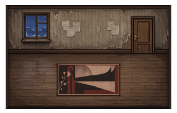

# Allegro: The Game


An early-stage 2D narrative RPG prototype built in Godot 4 (currently a single playable room vertical slice) with an original classical soundtrack, custom GLSL post-processing shaders, and a Python/Pillow asset pipeline for 3/4 top-down pixel-snapped scenes with painterly interior shading.

<p align="center">
  
  
</p>

## Architecture

The project separates runtime gameplay in GDScript from offline asset
compilation in Python:

| Path | Role |
|---|---|
| `title_screen.tscn`, `scripts/title_screen.gd` | Title screen with asynchronous background scene preloading |
| `intro_cutscene.tscn`, `scripts/intro_cutscene.gd` | 7 AM waking sequence in 4-tone Bayer 4x4 dithering (`320x180`) |
| `house_modular.tscn`, `dorm_modular.tscn` | Playable Y-sorted interiors with wall occluders and `PointLight2D` |
| `scripts/player.gd` | 4-direction movement with alternating stride phase and footstep pitch jitter |
| `scripts/room_atmosphere.gd` | Dynamic tungsten lamp toggle, window cloud drift, dust particles |
| `scripts/dynamic_shadow.gd` | Contact shadows and real-time directional cast shadows from light sources |
| `assets/shaders/` | Canvas shaders (`night_film.gdshader`, `bayer_cutscene.gdshader`) |
| `tools/` | Python (`Pillow`, `numpy`) and editor scripts for atlas slicing, deskewing, and normal maps |

## Asset Pipeline

Paintings and sprite sheets are processed into Godot-ready atlases using the
scripts under `tools/`:

- `clean_hero_sheet.py`: extracts `48x48` character frames into a `3x4` sheet
  (`assets/characters/hero_allegro_sheet.png`) while locking head alignment
  across stride frames.
- `polish_sprites.py`: downscales painterly crops with Lanczos inside the shape
  while snapping outer silhouettes cleanly at `Nearest` resolution and syncing
  palette tones against `assets/allegro_sepia_score.gpl`.
- `build_house_tileset.py`, `build_dorm_tileset_a.py`, `build_lighting_assets.py`:
  compile modular room atlases and radial/beam light textures.
- `sync_normals.py`: keeps sprite normal maps aligned with atlas coordinates.

Detailed palette values and canvas conventions live in [STYLE_GUIDE.md](STYLE_GUIDE.md).

## Running Locally

Open `project.godot` in Godot 4.7 or newer and press Play (`title_screen.tscn`
is the configured main scene).

To run the offline asset tools:

```bash
python3 -m venv .venv
.venv/bin/pip install pillow numpy
.venv/bin/python tools/clean_hero_sheet.py
```
